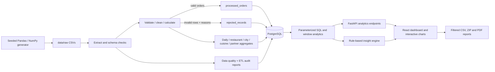

# University Jury Guide

## Project in one minute

**Food Delivery Analytics & Visualization System** is a complete data engineering and business analytics demonstration. It creates a related, reproducible Indian food delivery dataset; detects intentional data defects; preserves rejected records with reasons; calculates operational measures; stores validated data and audit history in PostgreSQL; then serves filtered SQL results through a React dashboard and FastAPI.

## Problem statement and usefulness

Delivery businesses need to see where order demand is strongest, which restaurants and cuisines contribute revenue, whether delivery promises are met, how cancellations vary by city, and whether input quality is trustworthy. A reliable decision starts with traceable source data and consistent metric definitions. This project demonstrates that flow end to end using synthetic data that is safe to share in an academic presentation.

## Architecture



## Dataset explanation

The generator creates 10,000 orders, 100 restaurants, and 250 delivery partners. Orders reference restaurant and partner IDs, contain timestamp milestones and commercial fields, and cover about six months in Indian cities. A fixed NumPy seed supports reproducibility. Master tables are clean. Raw orders deliberately include missing fields, duplicates, bad numeric values, invalid timestamps, unknown foreign keys, timestamp sequence issues, and invalid status values. These defects are useful for demonstrating validation, rejection, and audit logic.

The current checked-in run's ETL report records 10,000 source rows, 9,863 accepted orders, and 137 rejected rows. Always read the latest `data/reports/data_quality_report.json` for a fresh run's figures; a regenerated source may produce a different valid/rejected split if generator rules change.

## ETL explanation and quality handling

1. Extraction verifies the three files, encoding, expected columns, and nonempty contents.
2. Cleaning standardizes names and whitespace, normalizes blank values, parses timestamp fields, and converts numeric fields.
3. Validation checks mandatory fields, order ID uniqueness, customer ID format, master-data foreign keys, statuses, numeric rules, and timestamp order.
4. Invalid source rows are preserved separately with source line, original values, processing time, category, and multiple reasons on one rejected-record row.
5. Valid records receive preparation, delivery, and fulfilment durations; order date/month/hour; late flag; and restaurant/partner attributes.
6. SQL-ready performance datasets and an execution audit are written.
7. Optional PostgreSQL loading uses a transaction, bulk upsert, uniqueness/foreign-key constraints, and rollback on failure.

The pipeline never edits raw CSVs. Accepted plus rejected rows reconcile to the source row count. Rejection reason counts are issue counts and can exceed rejected row counts because one row may have multiple reasons.

## PostgreSQL schema explanation

- `restaurants` and `delivery_partners` are dimensions with natural primary keys.
- `processed_orders` is the validated fact table. Restaurant and partner IDs are foreign keys. It stores the enriched fields used by dashboard SQL.
- `daily_performance`, `restaurant_performance`, `city_performance`, `cuisine_performance`, and `delivery_partner_performance` hold ETL aggregate snapshots.
- `rejected_records` contains source-row number, original record JSONB, reasons, and execution ID. It has a separate storage path and never enters `processed_orders`.
- `etl_audit` records run IDs, timestamps, row counts, reasons, duration, database load status, and transformation metadata.
- Indexes support order-date, timestamp, city, status, restaurant, partner, and cuisine filtering.

## Important SQL concepts

`database/queries.py` includes bound date and dimension filters, conditional aggregation with PostgreSQL `FILTER`, CTEs for customer frequency, `LAG` for previous-period revenue, and window `AVG` for moving averages. `explain_analyze(engine, "city_analytics", ...)` inspects a predefined read query using PostgreSQL `EXPLAIN (ANALYZE, BUFFERS, FORMAT JSON)`.

Example revenue growth calculation:

```sql
100.0 * (revenue - previous_revenue) / previous_revenue
```

The query returns no growth value if the previous period has no positive revenue.

## Dashboard walkthrough

1. **Overview:** KPI cards, demand/revenue trends, status mix, restaurant/cuisine performance, delivery overview, and evidence-backed insights.
2. **Order Analytics:** daily/monthly volume, moving averages, revenue growth, payment/status mix, peak hour, weekday/weekend, and order heatmap.
3. **Forecast:** choose a city and a 7- or 14-day demand horizon; inspect the weekday-average forecast, empirical error band, and rolling 28-day backtest against a same-weekday baseline. Enter an order target and average order value in the what-if calculator to estimate completed orders and revenue using the filtered historical completion rate.
4. **Restaurant Analytics:** top revenue/order rankings, cuisine comparisons, rating and preparation-time comparisons, and a revenue-versus-rating quadrant.
5. **Delivery Analytics:** time distribution, partner ranking, vehicle comparison, city-by-vehicle comparison, distance scatter, and city delivery metrics.
6. **Customer Analytics:** unique/repeat customers, order frequency, delivered spending distribution, and top spenders. Order frequency counts valid statuses; spending counts delivered orders only.
7. **City & Geographic:** volume, revenue, delivery time, and cancellation rate, with city-centre markers for selected cities.
8. **Data Quality:** latest raw/accepted/rejected totals, issue categories, rejection reason chart, rejected-row inspection, and downloads.
9. **ETL Monitoring:** database audit history, durations, statuses, and rejection statistics.
10. **Upload Analysis:** profile a user-provided CSV temporarily with missing-value, duplicate, column-summary, and distribution views. Uploads are not retained or written to PostgreSQL.
11. **Automated Reports:** section CSVs, a ZIP bundle of full query results, and a summary PDF.
12. **About:** project context and definitions.

The geographic view uses city-centre coordinates sourced from GeoNames; marker size and color represent filtered order volume. These are city-level reference points, not restaurant, neighborhood, or rider GPS locations. The animated delivery journey explains the order lifecycle and does not represent a live route.

The order calendar heatmap shows daily volume by weekday. The order outcome flow summarizes actual filtered statuses. Restaurant quadrants plot revenue against rating with order-count bubbles. Delivery comparisons show average time by city and vehicle type. All are built from PostgreSQL query results.

Dash, the floating mascot guide, can lead a user through each dashboard page. It scrolls to and spotlights the relevant feature, then pops out an explanation beside it. Users can go back, continue, or close the walkthrough.

The sidebar date, city, restaurant, cuisine, payment, and status filters are parameterized in SQL and apply to business analytics pages. Filter options and query results are cached briefly. Quality and ETL pages show the latest ingestion/audit state rather than changing their source counts with order-analysis filters.

## KPI formulas

| KPI | Definition |
|---|---|
| Total orders | Count of validated orders under selected filters |
| Completed orders | Count with `order_status = delivered` |
| Cancelled orders | Count with `order_status = cancelled` |
| Revenue | Sum of `order_amount` for delivered orders |
| Average order value | Average delivered order amount |
| Average delivery time | Average delivered timestamp minus pickup timestamp, in minutes |
| Late deliveries | Delivered rows whose total fulfilment minutes exceed promised minutes |
| Late delivery percentage | Late delivered rows / all delivered rows × 100 |
| Cancellation rate | Cancelled rows / all filtered rows × 100 |
| Repeat customer | Customer with at least two validated orders under selected filters |

## Business insight rules

Insights are created by `analytics/insights.py` from live PostgreSQL result frames, never from a prose template with invented values. The rules are shown next to each insight. Current example thresholds are at least ten city orders and cancellation rate more than five percentage points above overall; restaurant late-rate alerts require at least five completed orders and a rate above both 10% and overall plus five points; low restaurant rating is below 3.5/5; strong partner requires five deliveries, rating of at least 4.5/5, and late rate no higher than overall. Rankings and peak hour are computed from the selected query results. A rule may yield no insight.

## Technology choices

- **Pandas/NumPy:** transparent data generation, cleaning, and structured transforms.
- **PostgreSQL:** relational constraints, durable records, JSONB audits/rejections, aggregation, and window functions.
- **SQLAlchemy/psycopg2:** managed connections, parameterized access, bulk writes, and transactions.
- **React + Vite:** interactive, modular browser dashboard.
- **FastAPI:** serves parameterized, database-backed analytics to the frontend.
- **Recharts / React Leaflet:** interactive charts and city-level map.
- **pytest:** repeatable unit and opt-in PostgreSQL integration checks.

## Setup and demonstration commands

```powershell
py -m venv .venv
.\.venv\Scripts\Activate.ps1
pip install -r requirements.txt
Copy-Item .env.example .env
# Edit .env with a PostgreSQL user who can create the application database.
python -m database.setup --create-database
python generate_dataset.py
python -m etl.pipeline --load-to-database
python -m database.check_data
npm.cmd --prefix frontend install
run_dashboard.bat
```

For PostgreSQL integration tests, set `TEST_DATABASE_URL` to a separate database name ending in `_test`, then run `pytest`. Unit tests can run without PostgreSQL; integration tests skip when the dedicated URL is not configured.

## 30 likely viva questions and answers

1. **What does the project do?** It generates food-delivery data, validates and transforms it, loads PostgreSQL, and presents SQL-backed analytics and reports.
2. **What problem does it address?** It demonstrates how to turn imperfect delivery records into traceable operational information.
3. **Why synthetic data?** It is reproducible, safe to distribute, and lets the project intentionally exercise quality rules without exposing personal data.
4. **How is the dataset reproducible?** The generator uses a configurable fixed NumPy random seed.
5. **Why separate restaurant and partner tables?** They are master dimensions referenced by orders, reducing duplicate descriptive data and enforcing referential integrity.
6. **What are the ETL stages?** Extract source CSVs, transform/validate records, and load output files or PostgreSQL.
7. **How are missing values handled?** Required missing fields cause rejection with recorded reasons; non-delivery milestone times may remain null where business rules allow.
8. **How are duplicate order IDs handled?** Every row participating in a duplicate key is rejected, and the reasons remain traceable.
9. **Are rejected rows deleted?** No. They are preserved in CSV and PostgreSQL `rejected_records`, separate from valid facts.
10. **How is traceability maintained?** The rejected record stores CSV source line, original fields, execution ID, timestamp, category, and reasons.
11. **How do you prove reconciliation?** The pipeline checks valid unique order rows plus rejected rows equals source rows; the database consistency command compares counts.
12. **What is a foreign key?** A relational constraint requiring the referenced restaurant or delivery partner to exist in its master table.
13. **What is a transaction?** A group of database changes that commit together or roll back together if any operation fails.
14. **What is an upsert?** An insert that updates a row on a primary/unique-key conflict, making repeated loads idempotent.
15. **How do you prevent passwords from entering source control?** Credentials come from environment variables or ignored `.env`; `.env.example` contains placeholders only.
16. **How is revenue defined?** Sum of order amount for completed/delivered orders; cancellations and failures contribute zero.
17. **How is average order value defined?** Mean order amount among delivered orders.
18. **How is delivery time defined?** Delivered timestamp minus pickup timestamp, expressed in minutes.
19. **How is late delivery defined?** Total fulfilment exceeds the order's promised delivery minutes.
20. **How is repeat ordering defined?** A customer has at least two validated orders under the selected filters.
21. **Why does customer spending use completed orders?** Cancelled orders did not fulfill a sale, so they count as activity but not delivered spend.
22. **How do global filters work?** Database-sourced selector values are passed as SQLAlchemy bound parameters to applicable SQL queries.
23. **Why use SQL aggregation instead of loading all orders into Python?** PostgreSQL can filter, group, and calculate aggregate results efficiently before returning them.
24. **What is a moving average?** A rolling mean over recent daily or monthly observations that smooths short-term variation.
25. **How is revenue growth calculated?** Current period revenue compared with previous period revenue as a percentage; it is undefined when the prior value is zero.
26. **How are insights kept evidence-based?** Each insight is generated from actual query rows and includes its evidence and rule threshold.
27. **How are map coordinates handled?** City-centre coordinates are sourced from GeoNames and documented in the frontend; they locate city aggregates only, never individual orders or riders.
28. **How is query performance inspected?** Predefined SQL can be run through PostgreSQL `EXPLAIN ANALYZE` with buffer details.
29. **How are database tests isolated?** Integration tests require a separate URL whose database name ends in `_test` and never drop the database.
30. **How should the predictor be interpreted?** It is a weekday-average baseline evaluated on the final 28 historical days against a same-weekday baseline; its empirical error band describes past backtest errors and is not a guarantee. The what-if calculator applies user assumptions to that database forecast. The synthetic dataset limits real-world predictive claims.

## Five-minute demonstration script

- **0:00–0:35 — Introduction:** State the problem and project goal: an auditable path from imperfect data to decisions.
- **0:35–1:05 — Data:** Show the generator, 10,000/100/250 row counts, fixed seed, and documented intentional data defects.
- **1:05–1:50 — ETL:** Run `python -m etl.pipeline --load-to-database`; explain validation, accepted/rejected traceability, calculated durations, and raw-file preservation.
- **1:50–2:20 — Database:** Show schema relationships, constraints, transactional upsert, audit and rejected tables; run `python -m database.check_data`.
- **2:20–3:45 — Dashboard:** Open Overview; use Dash to demonstrate the guided tour, adjust date/city/cuisine filters, and visit the order calendar and status flow, Forecast backtest and what-if calculator, restaurant revenue-rating quadrant, delivery city/vehicle comparison, customer repeat behavior, and city map.
- **3:45–4:20 — Quality and insight:** Open Data Quality and ETL Monitoring; show rejection reasons, latest audit, and explain one insight's evidence and rule.
- **4:20–4:45 — Upload and reports:** Profile a CSV on Upload Analysis (the upload is temporary), then show live CSV reports; the older Streamlit UI also has ZIP/PDF output.
- **4:45–5:00 — Close:** Summarize traceability, database-backed analytics, the baseline nature of the predictor, synthetic-data limitation, and possible future scheduled ingestion.

If PostgreSQL credentials are not available in the demonstration environment, show the code/configuration and previously generated ETL artifacts, clearly labeling the database workflow as not executed in that environment.
